# Fireworks Effects as SVG Filters

[~~Macromedia~~ Adobe Fireworks](https://en.wikipedia.org/wiki/Adobe_Fireworks)
was a fantastic drawing tool. I used it extensively: for websites, game
graphics, UI mockups, icons, and more. Sadly, as is the case for all good
things, it was killed by a large corporation.

To access my old files, I've been
[building a tool](https://github.com/davidje13/png-analyser) which can convert
Fireworks images into SVG, both for loading in modern editors, and for using
as-is. As part of this project, I needed to implement a wide variety of fill
effects and filters. I've tried to make these somewhat faithful to Fireworks'
behaviour, while also supporting high-resolution rendering and correct alpha
channel handling (something which the original filters often got wrong).


This article assumes you already have some familiarity with SVG in general and
[SVG filters](https://developer.mozilla.org/en-US/docs/Web/SVG/Tutorials/SVG_from_scratch/Filter_effects)
in particular, and you're curious to see how certain effects can be achieved.

So without further ado, a rundown of the effects and how I implemented them in
SVG, loosely ordered by difficulty:

- [Drop Shadow with Knockout](#drop-shadow-with-knockout)
- [Inner Shadow](#inner-shadow)
- [Inner Shadow with Knockout](#inner-shadow-with-knockout)
- [Solid Shadow / Extrude](#solid-shadow-extrude)
- [Solid Colour Solid Shadow](#solid-colour-solid-shadow)
- [Motion Blur](#motion-blur)
- [Radial / Zoom Blur](#radial-zoom-blur)
- [Add Noise](#add-noise)
- [Feather Fill](#feather-fill)
- [Conic Gradient](#conic-gradient)
- [Offset Glow / Halo](#offset-glow-halo)
- [Shadow Spread](#shadow-spread)
- [Bevel / Emboss](#bevel-emboss)
- [Outer Bevel](#outer-bevel)

## Drop Shadow with Knockout

The drop shadow is a widely used effect, and SVG supports it natively with
[`feDropShadow`], but it does _not_ natively support "knock out", where the
original shape is removed, leaving a hole in the shadow. It looks like this:

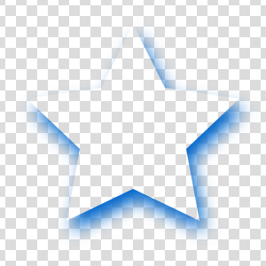
A star with a blue knockout drop shadow applied.

It is implemented like this:

```xml
<filter id="my-drop-shadow-knockout-filter">
  <feOffset dx="2" dy="4" in="SourceAlpha" /> <!-- x, y shift -->
  <feGaussianBlur stdDeviation="3" />         <!-- blur amount -->
  <feComposite operator="out" in2="SourceAlpha" result="b" />
  <feFlood flood-color="#0066CC" />           <!-- colour + opacity -->
  <feComposite operator="in" in2="b" />
</filter>
```

Don't forget to expand / shift the filter bounding box if you have a large
offset or blur, or your input shape is small[^svg-filter-margin].

### Walkthrough

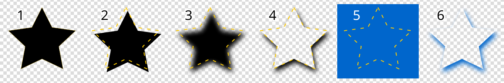

1. `SourceAlpha` is the outline of the shape;
2. [`feOffset`] translates this to where we want the shadow to be;
3. [`feGaussianBlur`] blurs this to look like a fuzzy shadow;
4. [`feComposite`] with `operator="out"` subtracts our original shape
   (`SourceAlpha`) from the blurred shadow;
   - (if we want a black shadow we could stop here and use the `opacity`
     attribute to change the shadow strength)
5. [`feFlood`] generates a solid colour for the shadow;
6. [`feComposite`] with `operator="in"` masks the flood colour with the shadow
   shape.

## Inner Shadow

An inner shadow gives the impression of a hole punched into the page. It looks
like this:

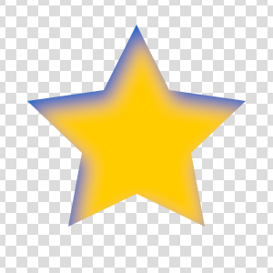 A star with a blue
inner shadow applied.

SVG also doesn't have a built-in effect for inner shadows, either with or
without knockout, but it can be implemented with a small variation on
[drop shadows](#drop-shadow-with-knockout):

```xml
<filter id="my-inner-shadow-filter">
  <feOffset dx="2" dy="4" in="SourceAlpha" />    <!-- x, y shift -->
  <feGaussianBlur stdDeviation="3" result="b" /> <!-- blur amount -->
  <feFlood flood-color="#0066CC" />              <!-- colour + opacity -->
  <feComposite operator="out" in2="b" />
  <feComposite operator="atop" in2="SourceGraphic" />
</filter>
```

### Walkthrough

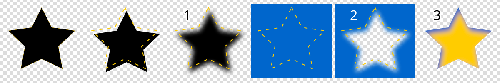

1. As before, we offset and blur the shape to make our shadow, except this time
   it will act as a _negative_ of the shadow;
2. [`feComposite`] with `operator="out"` subtracts the negative shadow from our
   solid shadow colour;
3. [`feComposite`] with `operator="atop"` applies the shadow within the original
   shape (this operator ensures the original alpha is preserved).

### Filter boundary

Even though the resulting effect does not expand beyond the input shape, we
still need our filter boundary to be larger. This avoids clipping in the
[`feOffset`] stage. However we do _not_ need to avoid clipping in the
[`feGaussianBlur`] stage, so our bounds only depend on the offset (if you want
to get really complicated about it, they only need to be as large as the
_minimum_ of the offset or the total blur radius, since anything further away
won't end up affecting the shadow anyway).

We can even reduce the bounds to a single quadrant (based on the offset we
pick). For example, if our offset is positive in x and y:

```xml
<filter x="0%" y="0%" width="110%" height="110%">
```

## Inner Shadow with Knockout

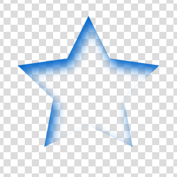
A star with a knockout inner shadow applied.

It is implemented like this:

```xml
<filter id="my-knockout-inner-shadow-filter">
  <feOffset dx="2" dy="4" in="SourceAlpha" />    <!-- x, y shift -->
  <feGaussianBlur stdDeviation="3" result="b" /> <!-- blur amount -->
  <feFlood flood-color="#0066CC" />              <!-- colour + opacity -->
  <feComposite operator="out" in2="b" />
  <feComposite operator="in" in2="SourceAlpha" />
</filter>
```

This is identical to the [inner shadow without knockout](#inner-shadow), except
the last stage has changed. The final stage here clips the shadow to the
original shape, rather than applying it on top of the original image.

## Solid Shadow / Extrude

Solid shadows are used to "extrude" an object, making it look somewhat
three-dimensional. First, a classic extrude which preserves the edge colours:

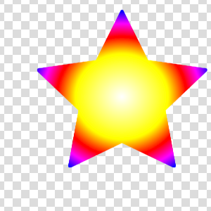
A star with a solid shadow applied.

SVG has no native support for them, and they're usually best achieved by adding
new vector shapes to the image, but it is possible to approximate them as a
filter if desired (e.g. to apply to text or dynamic content). These are easier
to implement programmatically since they need some repetition, but they are not
too hard to write by hand:

```xml
<filter id="my-solid-shadow-filter">
  <feOffset dx="0.125" dy="-0.0625" />
  <feComposite operator="over" in="SourceGraphic" result="025" />
  <feOffset dx="0.25" dy="-0.125" />
  <feComposite operator="over" in="025" result="05" />
  <feOffset dx="0.5" dy="-0.25" />
  <feComposite operator="over" in="05" result="1" />
  <feOffset dx="1" dy="-0.5" />
  <feComposite operator="over" in="1" result="2" />
  <feOffset dx="2" dy="-1" />
  <feComposite operator="over" in="2" result="4" />
  <feOffset dx="4" dy="-2" />
  <feComposite operator="over" in="4" result="8" />
  <!-- continue for deeper shadows -->
</filter>
```

Note that this involves discrete steps which build up exponentially. This means
we must chose the resolution of the effect. If the image is zoomed too much,
artifacts will become visible:

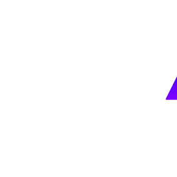
A super-close-up of the top of the star. Artifacts are visible at the corner.

The sub-pixel steps at the start can be increased to reduce this effect, at the
cost of slightly lower performance / larger images.

### Walkthrough

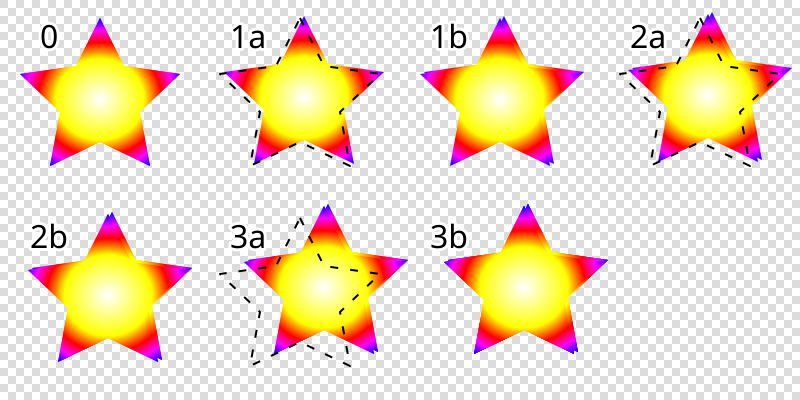

Each pair of [`feOffset`] + [`feComposite`] doubles the length of the shadow. We
begin with sub-unit distances so that it will look sharp when zoomed and on
high-resolution displays, then we quickly increase the length. Since the length
increases exponentially, the number of stages needed only increases
logarithmically with desired length.

1. 1. The first [`feOffset`] shifts the image by the smallest unit we want to
      use (the smaller this distance, the more the resulting image can be zoomed
      before looking coarse);
   2. [`feComposite`] with `operator="over"` stacks the original image back on
      top;
2. The next pair of operations do the same, but shift by twice the distance;
3. Each subsequent pair of operations doubles the distance again.

Non-power-of-two lengths can be achieved by combining relevant power-of-two
lengths. For example to get a length of 10, combine 8 and 2: (sub-pixel stages
omitted)

```xml
<feOffset dx="1" dy="-0.5" />
<feComposite operator="over" in="SourceGraphic" result="2" />
<feOffset dx="2" dy="-1" />
<feComposite operator="over" in="2" result="4" />
<feOffset dx="4" dy="-2" />
<feComposite operator="over" in="4" result="8" />

<feOffset dx="2" dy="-1" />
<feComposite operator="over" in="2" result="10" />
```

## Solid Colour Solid Shadow

To get a bit more definition, we can change the colour of a
[solid shadow](#solid-shadow-extrude)'s "edge", either by setting it to a fixed
colour, or by tinting it:

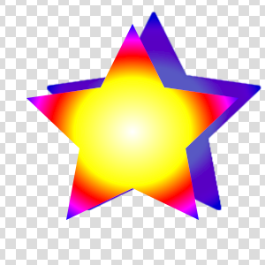
A star with a 90% solid blue shadow applied.

The implementation is the same as before, but with some prefix and suffix
stages:

```xml
<filter id="my-solid-shadow-colour-filter">
  <feFlood flood-color="#0000CC" flood-opacity="0.9" />
  <feComposite operator="atop" in2="SourceGraphic" result="0" />

  <feOffset dx="0.125" dy="-0.0625" />
  <feComposite operator="over" in="0" result="025" />
  <feOffset dx="0.25" dy="-0.125" />
  <feComposite operator="over" in="025" result="05" />
  <feOffset dx="0.5" dy="-0.25" />
  <feComposite operator="over" in="05" result="1" />
  <feOffset dx="1" dy="-0.5" />
  <feComposite operator="over" in="1" result="2" />
  <feOffset dx="2" dy="-1" />
  <feComposite operator="over" in="2" result="4" />
  <feOffset dx="4" dy="-2" />
  <feComposite operator="over" in="4" result="8" />
  <!-- continue for deeper shadows -->

  <feOffset dx="0.125" dy="-0.0625" />
  <feComposite operator="over" in="SourceGraphic" />
</filter>
```

### Walkthrough

The initial stages modify the colour of the image before the solid shadow is
generated. The final stages then push the shadow one final step away, and apply
the original image back on top.

## Motion Blur

A motion blur blurs the image in a specific direction, giving the impression of
movement or vibration which is too fast for a camera's shutter speed.

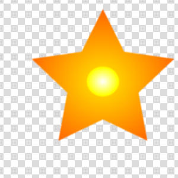
A linear motion blur.

The same technique from [solid shadows](#solid-shadow-extrude) can be used to
implement a motion blur; it just uses a different compositing operation:

```xml
<filter id="my-motion-blur-filter">
  <feOffset dx="0.125" dy="-0.0625" />
  <feComposite operator="arithmetic" k2="0.5" k3="0.5" in="SourceGraphic" result="025" />
  <feOffset dx="0.25" dy="-0.125" />
  <feComposite operator="arithmetic" k2="0.5" k3="0.5" in="025" result="05" />
  <feOffset dx="0.5" dy="-0.25" />
  <feComposite operator="arithmetic" k2="0.5" k3="0.5" in="05" result="1" />
  <feOffset dx="1" dy="-0.5" />
  <feComposite operator="arithmetic" k2="0.5" k3="0.5" in="1" result="2" />
  <feOffset dx="2" dy="-1" />
  <feComposite operator="arithmetic" k2="0.5" k3="0.5" in="2" result="4" />
  <feOffset dx="4" dy="-2" />
  <feComposite operator="arithmetic" k2="0.5" k3="0.5" in="4" result="8" />
</filter>
```

[`feComposite`] with `operator="arithmetic"` and `k2="0.5" k3="0.5"` averages
the two inputs together.

When creating non-power-of-two lengths, we need to pick `k2` and `k3` based on
the relative lengths:

```xml
<feOffset dx="1" dy="-0.5" />
<feComposite operator="arithmetic" k2="0.5" k3="0.5" in="SourceGraphic" result="2" />
<feOffset dx="2" dy="-1" />
<feComposite operator="arithmetic" k2="0.5" k3="0.5" in="2" result="4" />
<feOffset dx="4" dy="-2" />
<feComposite operator="arithmetic" k2="0.5" k3="0.5" in="4" result="8" />

<feOffset dx="2" dy="-1" />
<feComposite operator="arithmetic" k2="0.2" k3="0.8" in="2" result="10" />
```

`k2` is the amount of `in` to use, `k3` is the amount of `in2` to use (here
`in2` defaults to the previous operation). Since we are combining the `2` and
`8` stages, the proportions are $\frac{2}{2 + 8} = 0.2$ and
$\frac{8}{2 + 8} = 0.8$.

## Radial / Zoom Blur

A radial blur blurs an image rotationally, making it look like it is spinning:

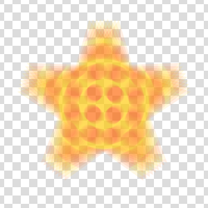
A radial motion blur.

For any non-linear motion blur, SVG's filters are too limited. There's no
matrix-based transformation; all we get is [`feOffset`]. It _might_ be possible
to use [`feDisplacementMap`] with a carefully curated map, but that currently
has problems due to
[colour space bugs in Chrome](https://issues.chromium.org/issues/373410239#comment11),
and would be very complicated to implement anyway.

Instead of using filters, we can duplicate our element many times using
[`<use>`](https://developer.mozilla.org/en-US/docs/Web/SVG/Reference/Element/use):

```xml
<g style="isolation: isolate">
  <!-- arbitrary shape definition with id -->
  <path
    d="M0-41L12-17 40-13 20 6 25 33 0 21-25 33-20 6-40-13-12-17Z"
    id="my-path"
    opacity="0.11111"
    style="mix-blend-mode: plus-lighter"
  />
  <!-- transformed references -->
  <use href="#my-path" transform="rotate(-10)" transform-origin="center" style="transform-box: fill-box; mix-blend-mode: plus-lighter" />
  <use href="#my-path" transform="rotate(-7.5)" transform-origin="center" style="transform-box: fill-box; mix-blend-mode: plus-lighter" />
  <use href="#my-path" transform="rotate(-5)" transform-origin="center" style="transform-box: fill-box; mix-blend-mode: plus-lighter" />
  <use href="#my-path" transform="rotate(-2.5)" transform-origin="center" style="transform-box: fill-box; mix-blend-mode: plus-lighter" />
  <use href="#my-path" transform="rotate(2.5)" transform-origin="center" style="transform-box: fill-box; mix-blend-mode: plus-lighter" />
  <use href="#my-path" transform="rotate(5)" transform-origin="center" style="transform-box: fill-box; mix-blend-mode: plus-lighter" />
  <use href="#my-path" transform="rotate(7.5)" transform-origin="center" style="transform-box: fill-box; mix-blend-mode: plus-lighter" />
  <use href="#my-path" transform="rotate(10)" transform-origin="center" style="transform-box: fill-box; mix-blend-mode: plus-lighter" />
</g>
```

### Walkthrough

In this example there are 9 copies of the object, so each has an opacity of
$\frac{1}{9} = 0.11111$. Normally combining opacities like this wouldn't work,
but we can use CSS'
[`mix-blend-mode: plus-lighter`](https://developer.mozilla.org/en-US/docs/Web/CSS/Reference/Properties/mix-blend-mode)
inside a group with
[`isolation: isolate`](https://developer.mozilla.org/en-US/docs/Web/CSS/Reference/Properties/isolation)
to make the semitransparent shapes _sum_ together.

With those parts implemented, it only remains to decide how to transform the
shape along its path. In this example, we use `transform="rotate(n)"` at
2.5-degree intervals (skipping 0 since that's covered by our original shape),
and set
[`transform-origin="center"`](https://developer.mozilla.org/en-US/docs/Web/SVG/Reference/Attribute/transform-origin)
and
[`transform-box: fill-box`](https://developer.mozilla.org/en-US/docs/Web/CSS/Reference/Properties/transform-box)
so that the rotation is around the centre of the shape. Any other transformation
can be used (zoom, skew, even 3D transformations).

Note that we do not get the exponential growth of the motion blur here; the cost
increases linearly with the number of instances we render. We could make the
image size logarithmic by nesting `<use>` blocks, but the performance would not
improve: unlike a filter, each instance must still be rendered independently.

The payoff from this relatively poor performance is a huge amount of
flexibility. We can apply any motion with this technique, and we can control the
individual opacities of each instance (allowing us to create window functions,
for example, for more realistic motion blurs), or even the colour (for effects
like chromatic aberration or rainbow motion blur).

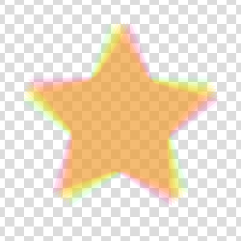
A radial motion blur with different colours and opacities along the path.

## Add Noise

At low intensities, adding random noise to an image can make solid fills and
gradients look more like physical materials. At higher intensities it can
provide a grainy low-light effect or a sand-like texture:

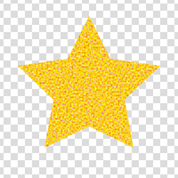 A star
with 150% colour noise added.

The core of this effect is easy to achieve in SVG using [`feTurbulence`]; SVG's
noise generating function. But we also need to perform some extra steps so that
we can apply the noise in "non-premultiplied" colour space.

### Premultiplied colour space

SVG's filters (with the exception of [`feComponentTransfer`] and
[`feColorMatrix`]) operate in "premultiplied" colour space. That means the red,
green, and blue channels are multiplied by the alpha (transparency); fully
transparent colours will always have red, green, and blue set to 0; 50%
transparent colours will have their red, green, and blue values halved, etc.
This has advantages for compositing performance and makes it easier to achieve
good looking results in most cases, but it is not always what we want.

In the case of adding noise, we get better results with non-premultiplied alpha.
It's easiest to understand with a visual example:


Adding noise to shapes with semi-transparency, with and without premultiplied
alpha.

Even without explicit semitransparent areas, this effect still manifests in the
antialiased edge pixels, so we should use non-premultiplied colour when adding
noise regardless of our source image.

Sadly SVG doesn't offer a way to control the behaviour, but we can achieve this
by performing our own "de-multiplication" and "re-multiplication" stages:

```xml
<!-- de-multiply alpha (set alpha to 1 everywhere) -->
<feComponentTransfer>
  <feFuncA type="linear" slope="0" intercept="1" />
</feComponentTransfer>

<!-- (other operations -->

<!-- re-multiply alpha -->
<feComposite operator="in" in2="SourceAlpha" />
```

### Implementation

With the colour space handled, we can implement the Add Noise filter. This
specific example adds _signed_ noise (i.e. noise which can brighten or darken
the image) independently to each of the red, green, and blue channels:

```xml
<filter id="my-noise-filter" x="0%" y="0%" width="100%" height="100%">
  <!-- de-multiply alpha -->
  <feComponentTransfer result="r">
    <feFuncA type="linear" slope="0" intercept="1" />
  </feComponentTransfer>
  <!-- generate noise -->
  <feTurbulence
    numOctaves="1"
    baseFrequency="1"
    seed="0"
    type="fractalNoise"
  />
  <feComponentTransfer>
    <feFuncA type="linear" slope="0" intercept="1" />
  </feComponentTransfer>
  <!-- add noise -->
  <feComposite
    operator="arithmetic"
    in2="r"
    k2="1.50"
    k3="1"
    k4="-0.75"
  />
  <!-- re-multiply alpha -->
  <feComposite operator="in" in2="SourceAlpha" />
</filter>
```

### Walkthrough

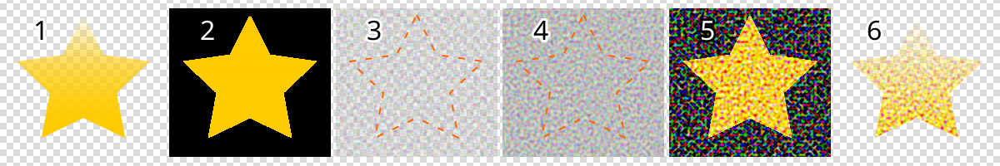

1. `SourceGraphic` is our input image;
2. [`feComponentTransfer`] is used to set the alpha to 1 everywhere
   (de-multiplying the colour channels);
3. [`feTurbulence`] with `numOctaves="1"` generates simple uniform random noise
   ("white noise"), at a scale of `1 / baseFrequency`;
4. [`feComponentTransfer`] is again used to set alpha to 1 everywhere,
   discarding the alpha component of the noise;
   - if we want monotone noise, we could swap this stage for an
     [`feColorMatrix`], such as this for grayscale noise:
     ```xml
     <feColorMatrix type="matrix" values="
       1 0 0 0 0
       1 0 0 0 0
       1 0 0 0 0
       0 0 0 0 1
     " />
     ```
5. [`feComposite`] with `operator="arithmetic"` is used to add the noise on to
   the de-multiplied image;
   - `k2` controls the amount of noise, and `k4` controls the offset (when `k4`
     = `k2 * -0.5`, the noise is applied symmetrically).
6. [`feComposite`] with `operator="in"` re-applies the original image alpha.

## Feather Fill

Feather fills make the edges of a shape softer without blurring the contents:

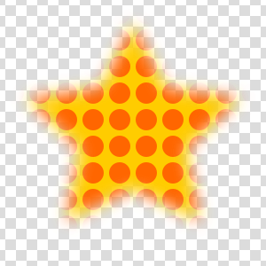 A
star with a pattern fill and feathered edge.

If we have a solid fill, we can simply blur the object, but if we have a more
complex fill (gradient, pattern, etc.) this would blur the fill itself, which we
do not want. Instead we can change our shape into an alpha mask, blur it, and
apply it to a shape which contains our (unblurred) fill:

```xml
<defs>
  <filter id="my-feather">
    <feGaussianBlur stdDeviation="3" /> <!-- feather amount -->
  </filter>
  <mask id="my-shape" mask-type="alpha">
    <!-- arbitrary shape definition, with filter applied -->
    <path
      d="M0-41L12-17 40-13 20 6 25 33 0 21-25 33-20 6-40-13-12-17Z"
      fill="black"
      filter="url(#my-feather)"
    />
  </mask>
</defs>
<rect
  x="0"
  y="0"
  width="100%"
  height="100%"
  fill="url(#whatever-fill)"
  mask="url(#my-shape)"
/>
```

The `<rect>` must cover the entirety of the blurred shape, but should ideally
not be too large (to avoid rendering large areas of fill unnecessarily).

It's possible to do something similar entirely in a filter (by blurring only the
alpha channel), but the result is broken due to there being no colour
information for pixels which were transparent; the shape is left with a fuzzy
black border, rather than being properly feathered.

## Conic Gradient

Conic gradients (also known as Angle gradients) sweep a gradient clockwise or
counterclockwise around a focal point:

A star with a conic gradient.

SVG does not support conic gradients, but CSS does. We can use a
[`<foreignObject>`](https://developer.mozilla.org/en-US/docs/Web/SVG/Reference/Element/foreignObject)
to embed a div which has the conic gradient applied, then mask it to our
original shape:

```xml
<mask id="my-shape" mask-type="alpha">
  <!-- arbitrary shape definition -->
  <path
    d="M0-41L12-17 40-13 20 6 25 33 0 21-25 33-20 6-40-13-12-17Z"
    fill="black"
  />
</mask>
<foreignObject width="100%" height="100%" mask="url(#my-shape)">
  <div
    xmlns="http://www.w3.org/1999/xhtml"
    style="
      height: 100px;
      background: conic-gradient(
        from 10deg at 50px 50px,
        #FF0000 0%,
        #FFFF00 16.6%,
        #00FF00 33.3%,
        #00FFFF 50%,
        #0000FF 66.7%,
        #FF00FF 83.3%,
        #FF0000 100%
      )
    "
  ></div>
</foreignObject>
```

**Warning**: Safari handles `foreignObject` positioning differently from other
browsers if the `viewBox` does not begin at 0, 0.

Also notice that the height of the `div` must be set explicitly. This size shown
in pixels is actually interpreted in SVG units. Using percentages (e.g. `100%`)
will work in some browsers, but not others.

In general, `foreignObject`s limit compatibility across browsers and with image
editing software. It is best to avoid them if possible, but conic gradients are
one example where there is currently no alternative.

## Offset Glow / Halo

An offset glow adds a halo around a shape starting at a chosen distance:

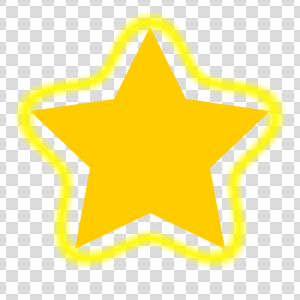
A star with an offset glow. The distance is slowly animating between two values.

Without the offset, this is easy to achieve by using a shadow, but adding the
offset takes a bit more work.

### Distance Map

To put a glow at a particular distance, we need to know the distance from each
point to our shape.

SVG doesn't have a distance filter (it may be possible to repeatedly apply
[`feMorphology`] or an [`feConvolveMatrix`], but that would be quite slow), but
it does have [`feGaussianBlur`], which can be used as a reasonable approximation
(albeit a non-linear one, and one which clips sharp corners).

After Gaussian blurring an opaque shape, we have a distance map based on the
[error function](https://en.wikipedia.org/wiki/Error_function). Specifically,
for a blur with a standard deviation of $\sigma$, defined as:

$$
\frac{1}{\sqrt{2 \pi \sigma^2}}e^{-\frac{x^2}{2 \sigma^2}}
$$

The indefinite integral is:

$$
\frac{1}{2} \text{erf}\left(\frac{x}{\sqrt{2} \sigma}\right)
$$

Which we can use to plot expected values by distance from the (smoothed) edge:

```json plot
{
  "title": "Gaussian blur output with a standard deviation of 3.",
  "type": "cartesian",
  "axes": [
    { "label": "distance from edge", "range": [-10, 10], "grid": [10, 2] },
    { "label": "value", "range": [-0.05, 1.05], "grid": [0.5, 0.1] }
  ],
  "aspect": 2,
  "elements": [
    {
      "type": "equation",
      "equation": "y=0.5-erf(x/(sqrt(2)*s))*0.5",
      "parameters": { "s": 3 },
      "description": "The negated and scaled error function, from 1 inside the shape, to 0.5 on the edge, and 0 outside the shape"
    }
  ]
}
```

We could create a mapping to convert these values directly into the glow amount
we want at each distance, but it's more flexible (and, potentially, animatable)
to split the process into stages:

1. Linearise our distance function using a static lookup table;
2. Apply simple linear transforms to set the glow offset and size;
3. Convert the new distance into our chosen glow shape (e.g. a Gaussian, Sine,
   triangle, etc.) using a second static lookup table.

Looking at the shape of the output above, we should be able to create a distance
map from -6 to +6 (i.e. from $-2\sigma$ to $+2\sigma$) before losing too much
accuracy. Our desired linear output is:

```json plot
{
  "title": "Desired linear distance function.",
  "type": "cartesian",
  "axes": [
    { "label": "distance from edge", "range": [-10, 10], "grid": [10, 2] },
    { "label": "value", "range": [-0.05, 1.05], "grid": [0.5, 0.1] }
  ],
  "aspect": 2,
  "elements": [
    {
      "type": "equation",
      "equation": "y=clamp(0.5-x/w,0,1)",
      "parameters": { "w": 12 },
      "description": "a flat line which is 1 at -6 and 0 at +6, outside this range it stays constant"
    }
  ]
}
```

Which is simply the equation: $\frac{1}{2} - \frac{x}{4 \sigma}$ clamped to the
range [0 1]. Combining these two:

$$
\text{lineariser}(v) = \frac{1}{2} - \frac{\sqrt{2}}{4} \text{erf}^{-1}(1-2v)
$$

```json plot
{
  "title": "Value lookup to convert a Gaussian blur into a linear distance map.",
  "type": "cartesian",
  "axes": [
    { "label": "input", "range": [0, 1], "grid": [1, 0.1] },
    { "label": "output", "range": [0, 1], "grid": [1, 0.1] }
  ],
  "elements": [
    {
      "type": "equation",
      "equation": "y=clamp(0.5-ierf(1-2x)*sqrt(2)*0.25,0,1)",
      "description": "a lookup table for converting values"
    }
  ]
}
```

With this mapping, an output of 0 means a distance of $+2 \sigma$, and an output
of 1 means a distance of $-2 \sigma$. Visualising it:

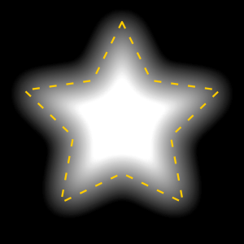
Distance map for a star, using $\sigma = 5$ (giving distances from -10 to +10
units).

To turn this mapping into something we can use in SVG filters, we need to
convert it to a lookup table by sampling it at regular intervals (to conform to
[`feComponentTransfer`]'s API). Using 21 values fits closely enough for good
results:

```text
-0.068 0.089 0.180 0.241 0.290 0.331 0.369 0.404 0.437 0.469 0.500 0.531 0.563 0.596 0.631 0.669 0.710 0.759 0.820 0.911 1.068
```

Notice that the first and last values are not in the [0 1] range; they have been
extrapolated to make the last parts of the curve fit more closely without
needing to increase the number of samples. We can do this because the SVG filter
will clamp the output to [0 1] anyway.

The filter code for our distance map is:

```xml
<feGaussianBlur stdDeviation="5" in="SourceAlpha" />
<feComponentTransfer>
  <feFuncA
    type="table"
    tableValues="-0.068 0.089 0.180 0.241 0.290 0.331 0.369 0.404 0.437 0.469 0.500 0.531 0.563 0.596 0.631 0.669 0.710 0.759 0.820 0.911 1.068"
  />
</feComponentTransfer>
```

Conveniently, because this is the alpha channel we do not need to worry about
the
[`color-interpolation-filters`](https://developer.mozilla.org/en-US/docs/Web/SVG/Reference/Attribute/color-interpolation-filters)
setting.

### Semitransparency

As written, our distance map does not do well with semitransparent shapes:

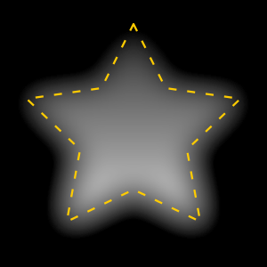
Distance map for a star with a semitransparent gradient fill.

What does the distance even mean for a semitransparent shape? Where is the edge?
We need to define it more explicitly by picking a threshold opacity which we
will measure distance from:

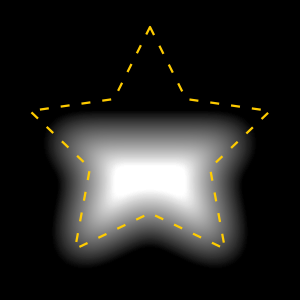
Distance map for a star with a semitransparent gradient fill and a threshold of
0.5.

```xml
<feComponentTransfer in="SourceAlpha">
  <!-- intercept controls the threshold, from -100 to 0 -->
  <feFuncA type="linear" slope="101" intercept="-50" />
</feComponentTransfer>
<feGaussianBlur stdDeviation="5" />
<feComponentTransfer>
  <feFuncA
    type="table"
    tableValues="-0.068 0.089 0.180 0.241 0.290 0.331 0.369 0.404 0.437 0.469 0.500 0.531 0.563 0.596 0.631 0.669 0.710 0.759 0.820 0.911 1.068"
  />
</feComponentTransfer>
```

### Implementation

Now that we have a distance map, all that remains is to decide what shape we
want the glow to be and apply the mapping:

```xml
<filter id="my-offset-glow-filter" x="-20%" y="-20%" width="140%" height="140%">
  <feComponentTransfer in="SourceAlpha">
    <!-- intercept controls the threshold, from -100 to 0 -->
    <feFuncA type="linear" slope="101" intercept="-50" />
  </feComponentTransfer>
  <!-- stdDeviation is half the maximum glow distance -->
  <feGaussianBlur stdDeviation="5" />
  <!-- linearise -->
  <feComponentTransfer>
    <feFuncA
      type="table"
      tableValues="-0.068 0.089 0.180 0.241 0.290 0.331 0.369 0.404 0.437 0.469 0.500 0.531 0.563 0.596 0.631 0.669 0.710 0.759 0.820 0.911 1.068"
    />
  </feComponentTransfer>
  <!-- slope and intercept control glow position and width -->
  <feComponentTransfer>
    <feFuncA type="linear" slope="3" intercept="0" />
  </feComponentTransfer>
  <!-- map to a triangle shape for the glow -->
  <feComponentTransfer result="b">
    <feFuncA type="table" tableValues="0 1 0" />
  </feComponentTransfer>
  <!-- set colour -->
  <feFlood flood-color="#FFEE00" />
  <feComposite operator="in" in2="b" />
  <feComposite operator="over" in2="SourceGraphic" />
</filter>
```

To save some steps at the cost of losing some code clarity, we could combine the
[`feFlood`] step into the [`feComponentTransfer`] above it:

```xml
<!-- [...] -->
<feComponentTransfer>
  <feFuncA type="linear" slope="3" intercept="0" />
</feComponentTransfer>
<feComponentTransfer color-interpolation-filters="sRGB">
  <feFuncR type="linear" intercept="1" slope="0" />
  <feFuncG type="linear" intercept="0.95" slope="0" />
  <feFuncB type="linear" intercept="0" slope="0" />
  <feFuncA type="table" tableValues="0 1 0" />
</feComponentTransfer>
<feComposite operator="over" in2="SourceGraphic" />
```

Of course we can also get much more imaginative with our glow shapes, and even
create multicoloured glows:

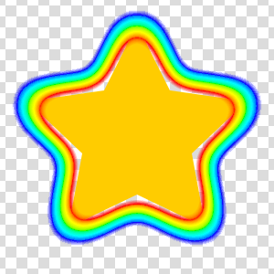 A star with a rainbow
glow.

## Shadow Spread

Since we have a distance map from implementing the
[offset glow](#offset-glow-halo), we can make a bonus effect which neither
Fireworks nor SVG support natively. CSS'
[`box-shadow`](https://developer.mozilla.org/en-US/docs/Web/CSS/Reference/Properties/box-shadow)
accepts a "spread" parameter to enlarge or shrink a shadow. We can do the same
for arbitrary shapes:

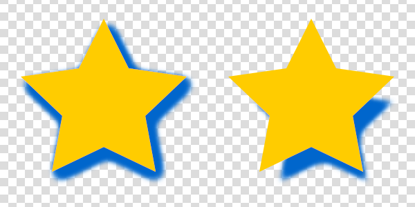
Stars with expanded and reduced drop shadows.

```xml
<filter id="my-shadow-filter">
  <feOffset dx="2" dy="3" in="SourceAlpha" /> <!-- x, y shift -->
  <feGaussianBlur stdDeviation="3" />         <!-- scale -->
  <feComponentTransfer>
    <feFuncA type="table" tableValues="-0.068 0.089 0.180 0.241 0.290 0.331 0.369 0.404 0.437 0.469 0.500 0.531 0.563 0.596 0.631 0.669 0.710 0.759 0.820 0.911 1.068" />
  </feComponentTransfer>
  <feComponentTransfer>
    <!-- spread and blur -->
    <feFuncA type="linear" slope="2" intercept="0" />
  </feComponentTransfer>
  <feComponentTransfer result="b">
    <feFuncA type="table" tableValues="0 0.003 0.008 0.018 0.036 0.067 0.115 0.184 0.274 0.382 0.500 0.618 0.726 0.816 0.885 0.933 0.964 0.982 0.992 0.997 1" />
  </feComponentTransfer>
  <!-- shadow colour -->
  <feFlood flood-color="#0066CC" />
  <feComposite operator="atop" in2="b" />
  <feComposite operator="over" in="SourceGraphic" />
</filter>
```

To achieve a blur with spread $s$, and standard deviation $\sigma$, the
properties should be set to:

- `stdDeviation` ($r$) $\ge \frac{1}{2} \left( |s| + 3 \sigma \right)$
- `slope` $= \frac{2 r}{3 \sigma}$
- `intercept` $= \frac{1}{2} - \frac{2r-s}{6 \sigma}$

If the `stdDeviation` ($r$) is set exactly as above, the `slope` and `intercept`
equations simplify:

- `slope` $= \frac{|s|}{3 \sigma} + 1$
- `intercept` = 0 for expanded ($s \ge 0$), and = `1 - slope` for reduced
  ($s < 0$)

### Walkthrough

This begins with the same distance map calculation as a glow, then applies a
different mapping at the end. This time we want to return to a Gaussian blur, so
we need to map to its integral (the error function). Since we can again perform
scaling and shifting as a separate step, we can assume a fixed centre point of
0.5 and standard deviation of $\frac{1}{6}$ to make good use of the input range:

$$
\frac{1}{2} + \frac{1}{2} \text{erf}\left(\frac{6(x-0.5)}{\sqrt{2}}\right)
$$

```json plot
{
  "title": "Blur mapping.",
  "type": "cartesian",
  "axes": [
    { "label": "input", "range": [0, 1], "grid": [1, 0.1] },
    { "label": "output", "range": [0, 1], "grid": [1, 0.1] }
  ],
  "elements": [
    {
      "type": "equation",
      "equation": "y=0.5+erf(6*(x-0.5)/sqrt(2))*0.5",
      "description": "the integral of a gaussian blur mapped to the range 0-1"
    }
  ]
}
```

Tabulated:

```text
0 0.003 0.008 0.018 0.036 0.067 0.115 0.184 0.274 0.382 0.500 0.618 0.726 0.816 0.885 0.933 0.964 0.982 0.992 0.997 1
```

(the first and last values have been set to 0 and 1 to avoid the effect leaking
beyond its bounds; the actual values for these points are 0.001 and 0.999, so
the difference is negligible)

## Bevel / Emboss

A bevel or emboss effect gives a shape a 3D look, adding the impression of
raised or lowered edges via lighting effects:

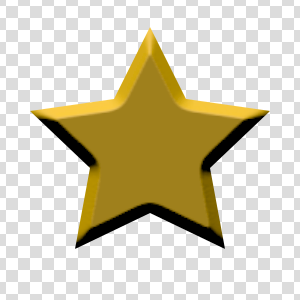
A star with a linear inner bevel effect applied. The light is slowly rotating
around the shape.

If you've ever wondered why SVG has so many lighting-related elements, the
answer is bevel / emboss effects (which were presumably more common when the
spec was written, and maybe will come back into fashion some day).

```xml
<filter id="my-bevel-filter" x="0%" y="0%" width="100%" height="100%">
  <feComponentTransfer in="SourceAlpha">
    <!-- intercept controls opacity threshold for edge detection -->
    <feFuncA type="linear" slope="101" intercept="-50" />
  </feComponentTransfer>
  <!-- stdDeviation = 0.5 * size of bevel -->
  <feGaussianBlur stdDeviation="2" />
  <feComponentTransfer result="height">
    <feFuncA type="table" tableValues="-0.068 0.089 0.180 0.241 0.290 0.331 0.369 0.404 0.437 0.469 0.500 0.531 0.563 0.596 0.631 0.669 0.710 0.759 0.820 0.911 1.068" />
  </feComponentTransfer>
  <feSpecularLighting
    surfaceScale="10"
    kernelUnitLength="0.5 0.5"
    specularConstant="0.1"
    specularExponent="10"
    result="specular"
  >
    <feDistantLight azimuth="-100" elevation="20" />
  </feSpecularLighting>
  <feDiffuseLighting
    surfaceScale="10"
    kernelUnitLength="0.5 0.5"
    diffuseConstant="1"
    in="height"
  >
    <feDistantLight azimuth="-100" elevation="20" />
  </feDiffuseLighting>
  <feComposite operator="arithmetic" in="SourceGraphic" k1="1" />
  <feComposite operator="atop" in="specular" />
</filter>
```

### Walkthrough

SVG provides [`feDiffuseLighting`] and [`feSpecularLighting`] for 3D effects.
Both operate on a height map provided in the alpha channel.

To generate this height map, we will again need the shape's distance map. See
[offset glow](#offset-glow-halo) for a discussion on how we obtain it. This
time, we'll convert it to a height map based on the 3D shape we wish to
represent. For example a simple linear inner bevel has a height map like this:

```json plot
{
  "title": "Height map for inner bevel of size 5.",
  "type": "cartesian",
  "axes": [
    { "label": "distance from edge", "range": [-10, 10], "grid": [10, 2] },
    { "label": "value", "range": [-0.05, 1.05], "grid": [0.5, 0.1] }
  ],
  "aspect": 2,
  "elements": [
    {
      "type": "equation",
      "equation": "y=clamp(x/-w,0,1)",
      "parameters": { "w": 5 },
      "description": "a flat line starting at 1 for larger negative values, descending linearly from x = -5 to 0, then continuing at 0 for positive values"
    }
  ]
}
```

Converting our distance map to this height map is simple:

```xml
<feComponentTransfer>
  <feFuncA type="linear" slope="2" intercept="-1" />
</feComponentTransfer>
```

However, using a height map which stops at 0 leads to a poor effect due to the
Gaussian blur's habit of cutting corners. To fix this, we can choose to either
embrace the rounding and clip the shape, or extend our height map "outside" the
shape:

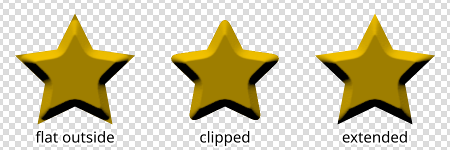
Various approaches for handling rounded corners. Notice that the first star has
flat sections at each tip due to the Gaussian blur rounding the corners away.

In this case, "extended" simply means using the original height map without
adjusting it (but doubling the `surfaceScale` property to maintain the same
overall shape). For more complicated height maps, extending the height function
may have different meanings.

By playing with the height function and compositing operations, we can create a
variety of effects:

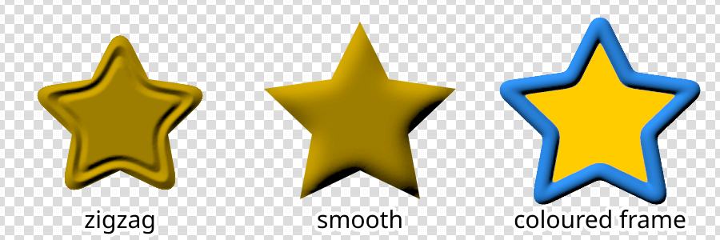
Variations on the bevel effect.

The coloured frame example shows a few ways to vary the effect; using a
different height function, different clipping thresholds, and different
compositing steps:

```xml
<filter id="my-frame-filter">
  <feGaussianBlur in="SourceAlpha" stdDeviation="2" result="blur" />
  <feComponentTransfer result="clip">
    <feFuncA type="linear" slope="101" intercept="-3" />
  </feComponentTransfer>
  <feComponentTransfer in="blur" result="clip-frame">
    <feFuncA type="linear" slope="101" intercept="-98.5" />
  </feComponentTransfer>
  <feComponentTransfer in="blur">
    <feFuncA type="table" tableValues="-0.068 0.089 0.180 0.241 0.290 0.331 0.369 0.404 0.437 0.469 0.500 0.531 0.563 0.596 0.631 0.669 0.710 0.759 0.820 0.911 1.068" />
  </feComponentTransfer>
  <feComponentTransfer>
    <feFuncA
      type="table"
      tableValues="0 0.5 0.8 0.95 1 0.95 0.8 0.5 0"
    />
  </feComponentTransfer>
  <feDiffuseLighting
    surfaceScale="3"
    kernelUnitLength="0.5 0.5"
    result="shading"
  >
    <feDistantLight azimuth="-120" elevation="40" />
  </feDiffuseLighting>
  <feFlood flood-color="#3399FF" />
  <feComposite operator="arithmetic" k1="1" in2="shading" />
  <feComposite operator="out" in2="clip-frame" />
  <feComposite operator="over" in2="SourceGraphic" />
  <feComposite operator="in" in2="clip" />
</filter>
```

## Outer Bevel

Bevels can also be _outside_ the shape, as long as they are given an explicit
colour:

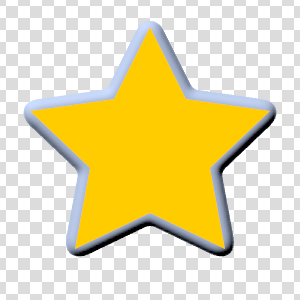
A star with a raised outer bevel.

We can implement this as a small variation of the
["coloured frame" bevel](#bevel-emboss):

```xml
<filter id="my-outer-bevel-filter">
  <feGaussianBlur in="SourceAlpha" stdDeviation="2" result="blur" />
  <feComponentTransfer result="clip">
    <feFuncA type="linear" slope="101" intercept="-2" />
  </feComponentTransfer>
  <feComponentTransfer in="blur">
    <feFuncA type="table" tableValues="-0.068 0.089 0.180 0.241 0.290 0.331 0.369 0.404 0.437 0.469 0.500 0.531 0.563 0.596 0.631 0.669 0.710 0.759 0.820 0.911 1.068" />
  </feComponentTransfer>
  <feComponentTransfer>
    <feFuncA
      type="table"
      tableValues="0 0.5 0.8 0.95 1 1 1 1 1"
    />
  </feComponentTransfer>
  <feDiffuseLighting
    surfaceScale="3"
    kernelUnitLength="0.5 0.5"
    result="shading"
  >
    <feDistantLight azimuth="-120" elevation="40" />
  </feDiffuseLighting>
  <feFlood flood-color="#CCDDFF" />
  <feComposite operator="arithmetic" k1="1" in2="shading" />
  <feComposite operator="in" in2="clip" />
  <feComposite operator="over" in="SourceGraphic" />
</filter>
```

## Further Reading

The internet is full of guides on achieving various SVG filter effects, so I
won't list specific sites here. As always,
[MDN](https://developer.mozilla.org/en-US/docs/Web/SVG/Reference/Element/filter)
is a great reference (though sometimes lacking references to useful filter
attributes).

If you ever used Fireworks and have some old PNGs you'd like to recover, give my
[PNG reader](https://github.com/davidje13/png-analyser) a try. It runs in the
browser and everything stays fully local. It still has a lot of limitations, but
if you find something big which it fails to handle, please let me know!

[^svg-filter-margin]:
    Eventually it should be possible to use the
    [filter margin](https://www.w3.org/TR/SVGFilter12/#FilterMarginAttribute) to
    set up filters which have the correct bounds regardless of the target
    shape's size, but this is not currently finalised or implemented in any
    browsers.

[`feColorMatrix`]:
  https://developer.mozilla.org/en-US/docs/Web/SVG/Reference/Element/feColorMatrix
[`feComponentTransfer`]:
  https://developer.mozilla.org/en-US/docs/Web/SVG/Reference/Element/feComponentTransfer
[`feComposite`]:
  https://developer.mozilla.org/en-US/docs/Web/SVG/Reference/Element/feComposite
[`feConvolveMatrix`]:
  https://developer.mozilla.org/en-US/docs/Web/SVG/Reference/Element/feConvolveMatrix
[`feDiffuseLighting`]:
  https://developer.mozilla.org/en-US/docs/Web/SVG/Reference/Element/feDiffuseLighting
[`feDisplacementMap`]:
  https://developer.mozilla.org/en-US/docs/Web/SVG/Reference/Element/feDisplacementMap
[`feDistantLight`]:
  https://developer.mozilla.org/en-US/docs/Web/SVG/Reference/Element/feDistantLight
[`feDropShadow`]:
  https://developer.mozilla.org/en-US/docs/Web/SVG/Reference/Element/feDropShadow
[`feFlood`]:
  https://developer.mozilla.org/en-US/docs/Web/SVG/Reference/Element/feFlood
[`feGaussianBlur`]:
  https://developer.mozilla.org/en-US/docs/Web/SVG/Reference/Element/feGaussianBlur
[`feMorphology`]:
  https://developer.mozilla.org/en-US/docs/Web/SVG/Reference/Element/feMorphology
[`feOffset`]:
  https://developer.mozilla.org/en-US/docs/Web/SVG/Reference/Element/feOffset
[`feSpecularLighting`]:
  https://developer.mozilla.org/en-US/docs/Web/SVG/Reference/Element/feSpecularLighting
[`feTurbulence`]:
  https://developer.mozilla.org/en-US/docs/Web/SVG/Reference/Element/feTurbulence
